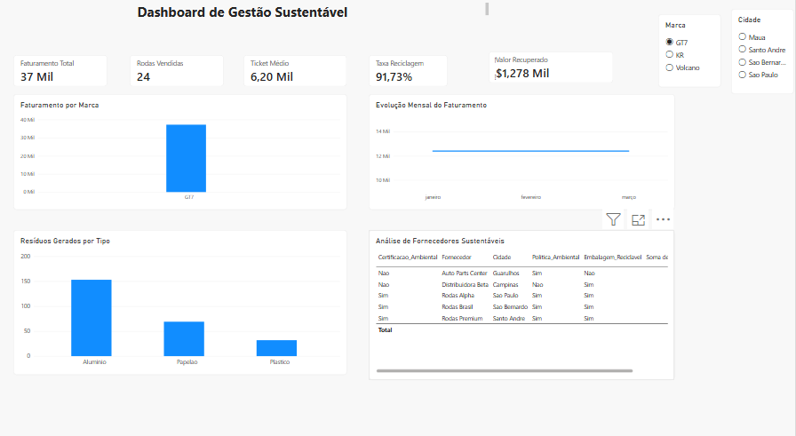

# ♻️ Loja Guga Rodas Sustentável

## 📌 Sobre o projeto

Projeto acadêmico de análise de dados desenvolvido para simular a gestão comercial e ambiental da Loja Guga Rodas.

O projeto utiliza dados fictícios de vendas, resíduos e fornecedores para demonstrar como a análise de dados pode apoiar decisões estratégicas e práticas sustentáveis.

## 🎯 Objetivos

- Analisar o desempenho comercial da loja.
- Monitorar indicadores de vendas.
- Avaliar a gestão de resíduos e reciclagem.
- Identificar oportunidades de melhoria.
- Desenvolver habilidades em Python, SQL e Power BI.

## 🛠️ Tecnologias utilizadas

- Python — análise e manipulação de dados.
- PostgreSQL — armazenamento dos dados.
- SQL — consultas e análise das informações.
- Power BI — criação de dashboards.
- GitHub — documentação e versionamento.

## 📂 Estrutura do projeto

- dados/ — arquivos CSV utilizados nas análises.
- python/ — scripts de análise de dados.
- sql/ — scripts e consultas SQL.
- powerbi/ — dashboard desenvolvido no Power BI.
- imagens/ — imagens e capturas do projeto.

## 📊 Indicadores analisados

### Indicadores comerciais
- Faturamento total.
- Quantidade de produtos vendidos.
- Ticket médio.

### Indicadores ambientais
- Taxa de reciclagem.
- Valor recuperado com resíduos.

## 🔎 Metodologia

1. Organização de dados fictícios de vendas, resíduos e fornecedores.
2. Estruturação das tabelas no PostgreSQL.
3. Desenvolvimento de consultas SQL.
4. Análise e tratamento de dados.
5. Criação de medidas e indicadores no Power BI.
6. Desenvolvimento de dashboard para visualização dos resultados.

## 📈 Resultados do projeto

O projeto permitiu construir uma solução demonstrativa para acompanhar indicadores comerciais e ambientais.

As análises possibilitam visualizar o desempenho das vendas, acompanhar métricas de reciclagem e explorar informações que podem apoiar a tomada de decisões.

Por utilizar dados fictícios, os resultados representam um cenário simulado e não o desempenho real da empresa.

## 🚀 Competências demonstradas

- Análise exploratória de dados.
- Consultas SQL.
- Modelagem básica de banco de dados.
- Construção de indicadores de desempenho (KPIs).
- Visualização de dados com Power BI.
- Organização e documentação de projetos.

## 📊 Dashboard — Loja Guga Rodas Sustentável

O dashboard foi desenvolvido no Power BI para apresentar indicadores de desempenho comercial e sustentabilidade, utilizando dados fictícios.

### Indicadores apresentados
- Faturamento total
- Quantidade vendida
- Ticket médio
- Taxa de reciclagem
- Valor recuperado

### Visualização do dashboard

O painel permite visualizar indicadores comerciais e ambientais, auxiliando na análise de resultados e na tomada de decisões em um cenário simulado.

## 👨‍💻 Autor

João Abner

Estudante de Análise e Desenvolvimento de Sistemas (ADS).

GitHub: https://github.com/Joaoabner1998

---

Projeto acadêmico desenvolvido para fins de aprendizado e construção de portfólio profissional.
